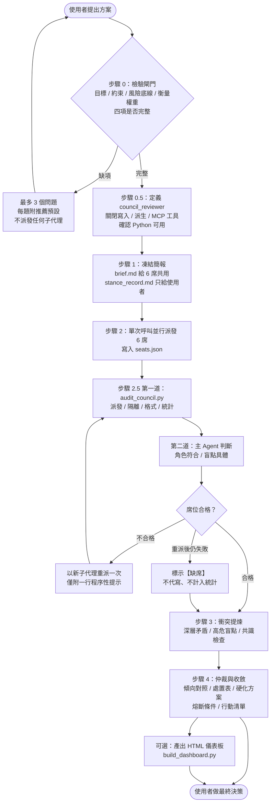
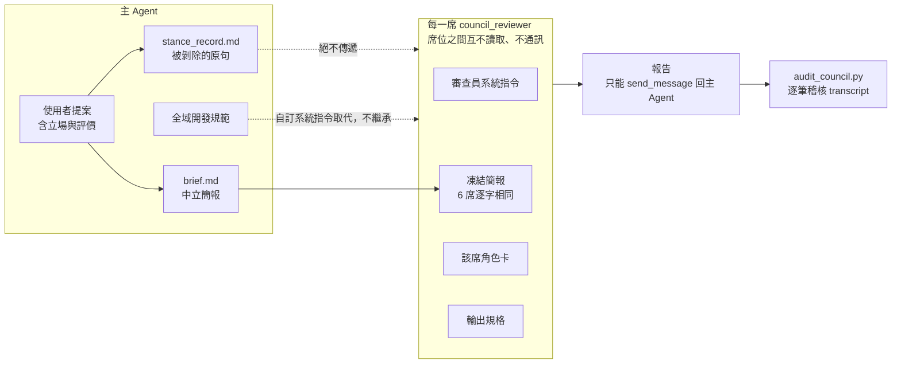
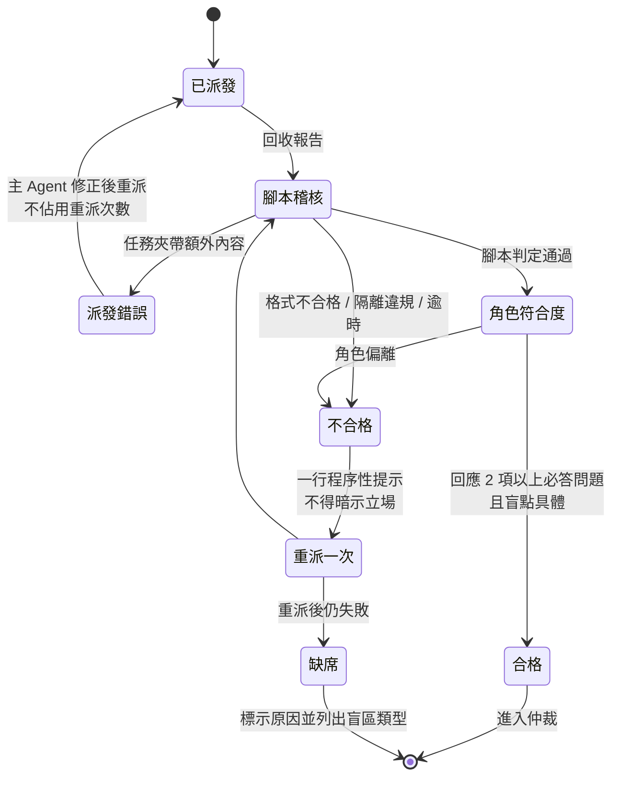
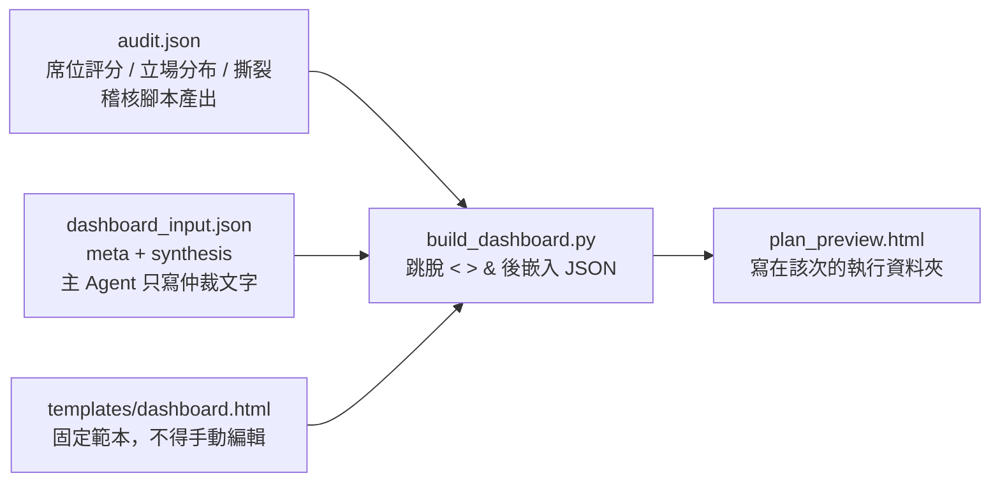

# agentic-council

給 [Antigravity](https://antigravity.google/)（agy）使用的**決策智囊團 skill**，採用 Orchestrator-Subagent 架構。

主 Agent 負責檢驗方案邊界、凍結中立簡報、仲裁衝突並做最後收斂。6 個法定席位以彼此隔離的唯讀子代理平行審查，各自從固定視角施加壓力測試。子代理的工具呼叫逐筆稽核，輸出採固定結構與六維評分；未產出合格報告的席位標示為缺席，主 Agent 不得代寫。

適用情境：技術架構重構、重大硬體採購、策略佈局、資產配置、行程與計畫加固等高風險的複雜決策。

目前版本：**v2.5.0**


> 上圖為範本內建的示範資料，不是真實審查結果。

---

## 目錄

- [為什麼需要它](#為什麼需要它)
- [特點](#特點)
- [六大審查席位](#六大審查席位)
- [整體流程](#整體流程)
- [隔離架構](#隔離架構)
- [席位的生命週期：稽核、重派與缺席](#席位的生命週期稽核重派與缺席)
- [視覺化儀表板](#視覺化儀表板)
- [安裝](#安裝)
- [使用方式](#使用方式)
- [檔案結構](#檔案結構)
- [每次執行會留下什麼](#每次執行會留下什麼)
- [更新紀錄](#更新紀錄)
- [授權](#授權)

---

## 為什麼需要它

直接問一個 AI「這個方案好不好」，常見的問題有三個：

1. **被你的語氣帶著走。** 你寫「我覺得 A 比較好」，答案就會往 A 靠。
2. **一個視角冒充多個視角。** 讓同一個對話輪流扮演「保守派」「激進派」，它們共享同一份上下文與同一個傾向，只是同一個偏見的多次回聲。
3. **看不出哪些是獨立判斷。** 多份意見都提到同一個風險時，你分不出是各自發現，還是被簡報預先點了題。

agentic-council 的做法是把這些問題當成工程問題處理：先把提案去立場化，再交給互不相通的獨立子代理，用腳本驗證它們沒有越線，最後由主 Agent 把衝突攤開仲裁。**最終決策權始終屬於使用者**，產出是建議，不含任何執行授權。

---

## 特點

### 1. 資訊不足就先停下來問

流程第一步是「檢驗閘門」：目標、資源與約束、風險底線、衡量權重四項核心邊界缺任何一項，就**不派發任何子代理**，只向使用者提出最多 3 個問題，每題附推薦預設選項。

### 2. 凍結中立簡報，並公開剝除了什麼

主 Agent 先把使用者提案改寫成只剩事實與選項的「Baseline Brief」，6 席共用同一份。使用者提案裡的評價性語句（例如「方案 A 明顯比較好」）被剝除後存進「立場剝除紀錄」，**絕不傳給任何子代理**，但最後會完整呈現給使用者，讓你檢查剝除得是否恰當。

v2.4.0 起，這條規則明確涵蓋簡報的每個段落（包含「已評估並排除的選項」），並加入第三道自檢：逐句比對剝除紀錄，確認被剝除的原句沒有以任何形式留在簡報裡。

### 3. 六席全員動員，缺席就是缺席

6 個席位每次都必須全員派發，不得刪減、合併或挑選子集。任何席位沒能產出合格報告，一律標示【缺席】，評分以「—」呈現，**主 Agent 不得代寫、補寫或推測缺席者的立場**。誠實的缺席比偽造的到席安全。

### 4. 能關的先關，關不掉的事後稽核

審查員使用專用的 `council_reviewer` 子代理類型：寫入、派生子代理、MCP 工具在類型定義時直接關閉。讀檔與通訊工具無法在平台層移除，改以系統指令設白名單，並由稽核腳本逐筆檢查 transcript。

### 5. 腳本是終局判定

[`scripts/audit_council.py`](scripts/audit_council.py) 機械式檢查：

- **派發一致性**：子代理實際收到的任務，是否由簡報、角色卡、輸出規格逐字組成，沒有夾帶其他文字。
- **隔離**：工具呼叫是否只有 `search_web`、`read_url_content`，以及寄給主 Agent 的 `send_message`。
- **格式**：必填欄位、立場四選一、六維評分為 1–10 整數、盲點標註、[外部來源] 附網址、字數。
- **統計**：立場分布與評分撕裂。

腳本判為不合格，主 Agent **不得推翻**，也不得手動修正報告讓它通過。語意層面的兩項判斷（角色符合、盲點具體）才由主 Agent 對照角色卡完成，並逐席寫出結果。

### 6. 能追溯到哪一席的結論

仲裁時，「傾向對照」必須逐項寫出席位編號，例如「基於席位 3 的 80/20 裁剪、席位 1 的預算防護」。只描述論點、不指名席位不算數，因為你要能回頭核對那一席的原始報告，分辨這是獨立論據還是單純附和。主方案的每一條也標註來源，主 Agent 自己加的標「主代理新增」。

### 7. 禁止編造數值

加固後的方案裡，**每一個數值只能來自使用者輸入或席位報告**，兩邊都查不到就不准寫。遇到需要數值的地方，改寫成待確認的驗證步驟，例如不寫「第 4–20 天完成搬遷」，改寫成「與團隊確認搬遷期起訖日後納入排程」。理由很直接：主 Agent 補的數字看起來和席位提出的一樣具體，使用者無從分辨哪個經過獨立審查。

### 8. 不替審查自己背書

覆蓋率聲明只寫四件事：到席席數、缺席席位與其盲區類型、未稽核席位、稽核結果。凡是形容這次審查多完整、多可信的句子（「涵蓋所有面向」「結論穩健」）一律禁止。稽核只能證明派發內容合規，無法證明 6 個視角窮盡了問題。

### 9. 反映真實分歧的圖解

儀表板由固定範本加腳本產生，主 Agent 只寫仲裁文字，不碰版面，也沒有機會轉抄評分。範本決定呈現方式，所以主 Agent 無法靠版面設計放大或淡化某一席的意見。細節見[視覺化儀表板](#視覺化儀表板)。

---

## 六大審查席位

| 席位 | 角色 | 專攻 |
|---|---|---|
| 1 | 極端保守派 (The Paranoiac) | 生存下限、最壞情況、黑天鵝、安全邊際 |
| 2 | 進取擴張者 (The Maximalist) | 天花板上限、機會成本、擴展爆發力 |
| 3 | 極簡實踐者 (The Pragmatist) | 執行摩擦、80/20 替代解、心智負擔 |
| 4 | 二階效應分析師 (The Systems Modeler) | 長期連鎖反應、反饋循環、非預期副作用 |
| 5 | 逆向破局者 (The Contrarian) | 推翻核心假設、相反路徑、非主流破局 |
| 6 | 人因審查員 (The Behavioral Auditor) | 人性怠惰、紀律損耗、疲勞下的有效性 |

角色卡放在 [`roles/`](roles/)，派發時逐字附加，不隨情境改寫。所有與當前問題相關的情境一律寫進簡報，而不是角色卡，所以 6 席看到的「問題」完全相同，差異只來自「視角」。

每席的輸出固定結構：

- **立場**四選一：支持推進 / 有條件推進 / 要求推倒重構 / 強烈否決。
- **六維評分**（1–10，越高對方案越有利）：生存安全、上限潛力、執行可行性、長期穩定、假設穩健度、人因可持續性。
- **最強支持理由**：即使立場是否決也必填。6 個角色本質上都是攻擊者，若只允許否決類立場，系統會系統性偏向負面，好方案也會被寫成災難預告。
- **致命盲點**：標註發生機率、衝擊與論據性質（[事實] / [外部來源] / [推測] / [假設]）。
- **防禦性底線**：這一席認為方案必須先滿足的條件。

---

## 整體流程



| 步驟 | 做什麼 | 關鍵規則 |
|---|---|---|
| 0 | 檢驗閘門 | 缺邊界就停，不派發 |
| 0.5 | 建立審查員子代理類型 | 每次執行都重新定義，不依賴先前的設定；環境不支援子代理時停止，不得單一 context 扮演 6 席 |
| 1 | 凍結簡報 | 6 席簡報逐字相同；簡報不得含評價、推薦或預判 |
| 2 | 平行派發 | 全員 6 席，單次呼叫；`seats.json` 記錄各席 transcript |
| 2.5 | 隔離稽核與回收驗證 | 腳本判定為終局；重派只有一次 |
| 3 | 衝突提煉 | 立場分布與評分撕裂直接採用腳本結果，不得自行重算 |
| 4 | 仲裁與收斂 | 方案內的數值必須有出處；覆蓋率聲明不得附總評 |

---

## 隔離架構

隔離是整套設計的前提。**任何在派發前就存在的傾向，不論來自主 Agent、使用者的措辭或全域規則，都會同時滲入全部 6 席**，6 份報告就不再獨立。



| 隔離方向 | 做法 |
|---|---|
| 橫向 | 各席嚴禁讀取其他席的輸出，也不得彼此通訊。稽核腳本檢查工具呼叫與收件對象。 |
| 縱向 | 各席只看得到「審查員系統指令 + 凍結簡報 + 固定角色卡 + 固定輸出規格」，看不到使用者立場、主 Agent 評價或全域規則。 |
| 工具 | 寫入、派生、MCP 在類型定義時關閉；讀檔與通訊以白名單加事後稽核處理。 |

> 平台無法強制阻止子代理透過絕對路徑讀檔，所以讀檔限制靠系統指令禁止加步驟 2.5 的稽核，而不是靠 `Workspace` 參數。

---

## 席位的生命週期：稽核、重派與缺席



幾個容易被忽略的細節：

- **「派發錯誤」是主 Agent 的責任**，不是席位的失敗，修正後重派不扣席位的重派次數。
- **重派提示只能指出程序問題**（例如「缺少六維評分」），不得暗示應採取何種立場、評分或內容方向。稽核腳本會把這行原文列出來，主 Agent 必須確認它沒有誘導。
- **缺席的席位**在報告區顯示【缺席】與失敗原因，評分全為「—」，不參與任何統計與圖表。缺席半數以上時，行動清單第一項建議重新召開審查。
- **篇幅超標**（900 字，席位 5 為 1200 字）只記警告，不判缺席，也不得因此重派。

---

## 視覺化儀表板

步驟 4 完成後，使用者可選擇產出 HTML 儀表板。頁面是**單一檔案，不需網路即可顯示**（只有字型從 Google Fonts 載入，離線時改用系統字型），支援桌面與手機寬度。



為什麼不讓主 Agent 直接寫 HTML：

- **版面一致**：每次的版面、配色與圖表畫法都相同。
- **評分不經手**：評分資料由腳本從 `audit.json` 帶入，主 Agent 沒有轉抄的機會，也無法透過版面放大或淡化某一席。
- **防止頁面壞掉**：報告內容可能含來自網路的文字，腳本會跳脫 `<`、`>`、`&`，內容含 `</script>` 也不會讓整頁失效。

### 頁面內容

頁面由上而下依序是：

| 區塊 | 內容 |
|---|---|
| **結論摘要**（v2.4.0 新增） | 與原傾向的對照標籤、一句話結論、前 3 條熔斷條件，並附連結跳到完整方案 |
| 總覽 | 立場分布條、評分撕裂表 |
| 六維評分 | 6 張雷達圖（缺席席位顯示【缺席】與原因）、色階評分矩陣 |
| 席位原始報告 | 預設折疊，附稽核判定 |
| 仲裁 | 深層矛盾、高危盲點、傾向對照、覆蓋率聲明 |
| 防禦性底線處置表 | 每席每條底線的採納 / 部分採納 / 駁回與理由 |
| 硬化後的主方案 | 附席位來源標籤；有時間欄位時顯示為時間軸（v2.4.0 新增） |
| 熔斷與止損條件、即刻行動清單 | 量化終止指標與前三項起步步驟 |


降級模式（單一 context 產出）或人工稽核時，頁面頂部會顯示警示橫幅。

### 結論摘要與時間軸的資料欄位

兩個新欄位都是選填，沒填時頁面維持舊版行為：

```json
{
  "synthesis": {
    "conclusion": "有條件推進：不一次性全面拆分，先備妥回退機制，只抽出痛點最大的一個模組試行。",
    "plan": [
      { "time": "拆分前",   "text": "先建立可一鍵回退的切換機制並演練一次。", "sources": [1] },
      { "time": "第一階段", "text": "只選痛點最大的一個模組抽出試行。",       "sources": [3, 5] }
    ]
  }
}
```

- `conclusion`：步驟 4 仲裁結論的一句話版本，只能從已寫好的結論逐字摘出，不得新增判斷。沒填時，結論卡改用傾向對照的說明文字。
- `plan[].time`：時間或階段（例如「11:45」「16:40–19:15」「拆分前」）。只要任一條填了，主方案就改用時間軸版面，時間顯示在左欄；行程類議題建議每條都填。

完整欄位規範見 [`templates/dashboard.md`](templates/dashboard.md)。

---

## 安裝

將本 repo clone 到 agy 的 skills 目錄：

```bash
# macOS / Linux
git clone https://github.com/SKR416/agentic-council.git ~/.gemini/config/skills/agentic-council
```

```powershell
# Windows
git clone https://github.com/SKR416/agentic-council.git "$env:USERPROFILE\.gemini\config\skills\agentic-council"
```

需求：

- 稽核腳本與儀表板腳本需要 Python 3（只使用標準函式庫）。找不到 Python 時，步驟 2.5 會改為人工稽核並在執行狀態列標註，且不產生儀表板。
- skills 目錄中不可有其他 `name: agentic-council` 的 SKILL.md，否則會互相遮蔽。
- 執行環境必須支援 `define_subagent` 與 `invoke_subagent`。不支援時流程會停下來告知，不會偷偷用單一 context 扮演 6 席。

---

## 使用方式

安裝後，在 agy 對話中描述你要審查的決策，並指明要用 agentic-council，例如：

> 我打算把單體服務拆成微服務，請用 agentic-council 幫我審查。

接下來流程如下：

1. 主 Agent 若發現邊界不完整，會先問你最多 3 個問題，每題都有推薦預設，你可以直接採用。
2. 邊界完整後，主 Agent 凍結簡報並派發 6 席。這段時間不需要你介入。
3. 完成後你會拿到：執行狀態列與稽核表、簡報與立場剝除紀錄（供你檢查剝除是否恰當）、6 份原始報告、仲裁、硬化後的方案，以及是否產出儀表板的選項。
4. 方案是建議，**最終決策與任何執行動作都由你決定**。

小提醒：

- 你的提案裡可以放心寫出傾向，主 Agent 會負責剝除；但事實與限制請寫清楚，簡報只能收錄你明確提供的內容，主 Agent 不得自行補寫背景知識。
- 中途修正方案視為新一輪審查，簡報重新凍結、6 席全部重派。
- 席位報告會連到網路搜尋，審查期間請預期需要一些時間。

---

## 檔案結構

```
├── SKILL.md                         # 流程、閘門與規則（agy 讀取的主檔）
├── roles/                           # 6 張固定角色卡（派發時逐字附加）
├── schemas/
│   ├── subagent_output.md           # 子代理輸出規格與六維評分定義
│   └── run_files.md                 # 執行資料夾檔案契約（seats.json、audit.json 等）
├── scripts/
│   ├── audit_council.py             # 機械式稽核腳本
│   ├── build_dashboard.py           # 儀表板產生腳本
│   └── transcripts/agy.py           # agy transcript 讀取
├── templates/
│   ├── reviewer_system_prompt.md    # 審查員子代理類型的系統指令
│   ├── retry_menu.md                # 重派固定提示選單
│   ├── preset_menu.md               # 推薦選項選單
│   ├── baseline_brief.md            # 凍結簡報模板（傳給子代理）
│   ├── stance_record.md             # 立場剝除紀錄模板（不得傳給子代理）
│   ├── dashboard.md                 # 儀表板資料欄位與產生規範
│   └── dashboard.html               # 儀表板固定範本（含示範資料）
├── tests/                           # pytest（python -m pytest tests -q）
└── docs/images/                     # README 使用的範例截圖
```

SKILL.md 與各模板檔「每次都逐字相同」是設計的核心：任何一個檔案讀取失敗，流程會立即停止並告知缺少哪個檔案，不得憑記憶重寫。

---

## 每次執行會留下什麼

每次執行的工作檔案寫在工作區的 `.council/runs/<YYYYMMDD-HHMMSS>/`：

| 檔案 | 內容 |
|---|---|
| `brief.md` | 凍結的中立簡報（6 席共用，全程不得修改） |
| `stance_record.md` | 被剝除的使用者立場（不傳給子代理，只給使用者檢查） |
| `seats.json` | 各席子代理 ID 與 transcript 路徑（填 `transcript_full.jsonl`，重派席位標 `retry`） |
| `audit.json` | 稽核腳本的判定、評分、立場分布與撕裂，是儀表板的資料來源 |
| `dashboard_input.json` | 儀表板的 `meta` 與 `synthesis`（若選擇產出儀表板） |
| `plan_preview.html` | 儀表板成品（若選擇產出儀表板） |

每次執行各用一個時間戳記資料夾，所以新的結果不會覆蓋舊的。

---

## 更新紀錄

### v2.5.0

依 Claude × Gemini 交叉審查的結果修正，重點是讓「主 Agent 能偷渡什麼」由腳本判定，而不是靠自律。

- **重派不能夾帶提示**：重派任務只能附 `templates/retry_menu.md` 的固定條目（最多 2 條），`seats.json` 記錄所選編號；其餘文字一律判「派發錯誤」。
- **紀錄檔不能偽造**：transcript 必須位於 agy brain 資料夾中該席對話編號之下，不符判「未稽核」且不讀取。
- **統計只算通過的席位**：「未稽核」與離題排除的席位不進立場分布、撕裂與圖表，原始報告照樣呈現。
- **離題排除**：主 Agent 以 `role_check` 排除席位時，必須逐字引用角色卡「必答問題」或「禁止」中完整的一條；只能排除，不能救回。
- **數字來源**：方案存成 `plan.md` 後執行 `--check-plan`，題目與通過席位報告中都找不到的數字一律列出，改寫為待確認步驟前不能定案。
- **錨定提示**：列出 2 席以上沿用的題目用詞（`anchoring_terms`），主 Agent 必須逐條交代。
- **輸出規格**：新增【必答回應】欄位（至少 2 題，由腳本計數）；字數改為建議上限 1,200／1,500 字；標 [外部來源] 必須真的呼叫過搜尋工具。
- **流程**：派出評審後只輸出一句就結束回合；評審以 send_message 交報告後只回「已完成回報」；凍結題目前確認使用者提過的數字都已寫入。
- **輸出**：腳本產生 `summary.md`、`report_full.md`，對話只貼摘要；儀表板預設產生，另列未稽核與離題排除名單。
- **安全邊界**：明列評審禁用工具；網頁內容與評審報告只是資料；主 Agent 只寫執行資料夾、只跑兩支腳本。
- **測試**：新增 `tests/`（pytest），涵蓋交叉審查發現的重派夾帶與偽造紀錄案例。

### v2.4.0

- **儀表板**：新增置頂的「結論摘要」卡（一句話結論、傾向對照標籤、前 3 條熔斷條件）。
- **儀表板**：主方案支援選填的 `time` 欄位，有填就改用時間軸版面，手機寬度自動改為上下排列。
- **簡報中立性**：撰寫禁令明確涵蓋「已評估並排除的選項」，排除原因只保留事實；新增凍結前第三道自檢，逐句比對立場剝除紀錄。
- **稽核可靠性**：`seats.json` 的 `transcript` 一律使用未截斷的 `transcript_full.jsonl`，避免緊湊版截斷過長提示造成稽核誤判「找不到簡報」。

### v2.3.x

- 儀表板改由 `build_dashboard.py` 與固定範本產生，並跳脫資料中的 `<`、`>`、`&`，防止資料跳出 script 區塊。

---

## 授權

[MIT](LICENSE)
